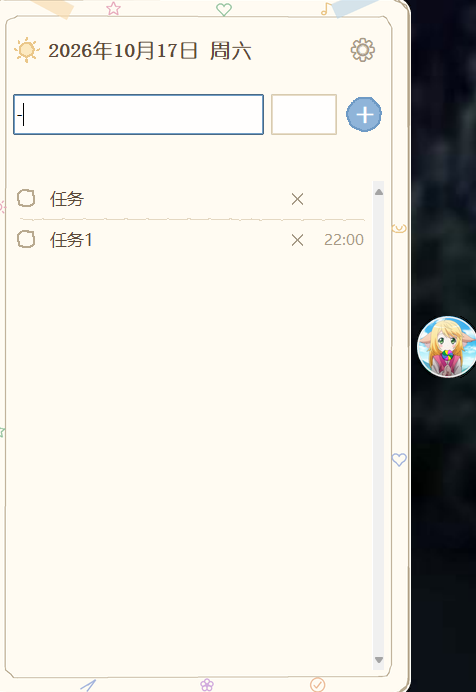

# FloatTask · 桌面悬浮任务清单

一款常驻 Windows 桌面的轻量级悬浮待办小工具。手绘简笔画风格、置顶显示、秒级增删勾选，数据完全本地存储，开箱即用。



## 功能特性

- **悬浮胶囊常驻桌面**：默认贴屏幕右边缘垂直居中、窗口置顶，不打断当前工作流；胶囊可自由拖动
- **一键展开 / 收起**：点击胶囊展开任务面板，点击面板外部自动收起
- **秒级任务操作**：
  - 新增：输入任务内容（必填）+ 计划时间（可选），回车或点击「+」即可添加
  - 勾选：点击复选框标记完成，已完成任务划线置灰、自动沉底
  - 编辑：双击任务行可修改文字与时间
  - 删除：点击任务行右侧「×」直接删除
- **今日视图**：显示所有未完成任务 + 今日完成的任务；未完成任务跨天自动顺延，昨天的待办今天依然在
- **开机自启**：设置中一键开关，通过 Windows 注册表 `HKCU\...\Run` 实现
- **个性化外观**：支持自定义面板背景图、自定义胶囊图标、调节胶囊大小；背景图完整保留原始清晰度
- **数据安全**：所有变更立即写入本地 `data.json`；文件损坏时自动备份为 `.bak` 并重建，不会崩溃
- **高分屏适配**：自动感知系统 DPI 缩放
- **单实例运行**：重复启动会自动聚焦到已有窗口
- **纯本地运行**：无任何网络请求，隐私零泄露

## 下载与安装

### 方式一：直接使用 exe（推荐，无需安装）

适用于 **Windows 10 / Windows 11**，目标电脑**无需安装 Python**。

1. 前往仓库的 [`dist/`](dist) 目录，下载可执行文件：[`dist/TaskList.exe`](dist/TaskList.exe)（约 31 MB，单文件绿色版）
2. 将 `TaskList.exe` 放到任意文件夹（建议单独建一个文件夹，例如 `D:\FloatTask\`）
3. **双击 `TaskList.exe` 即可运行**，无需安装向导
4. 首次运行后，程序会在 **exe 同级目录**自动生成 `data.json` 配置数据文件

> 提示：任务数据保存在 exe 同目录的 `data.json` 中。更换电脑时，把 `TaskList.exe` 和 `data.json` 一起拷贝走即可完整迁移。

### 方式二：从源码运行

适合有 Python 环境、希望自行修改代码的用户。

**环境要求**：Python 3.10 及以上（仅用到标准库 Tkinter 和 Pillow）

```bash
# 1. 克隆仓库
git clone https://github.com/li-kun-star/TaksList.git
cd TaksList

# 2. 安装依赖
pip install pillow

# 3. 运行
python main.py
```

### 方式三：自行打包成 exe

项目使用 [PyInstaller](https://pyinstaller.org/) 打包为单文件程序：

```bash
pip install pyinstaller pillow

pyinstaller --onefile --noconsole --name TaskList --add-data "20200726060256_nuoes.jpg;." main.py
```

打包完成后，可执行文件位于 `dist/TaskList.exe`。

## 使用说明

| 操作 | 方式 |
| --- | --- |
| 展开 / 收起面板 | 单击悬浮胶囊；展开后点击面板外部任意区域收起 |
| 移动胶囊位置 | 按住胶囊拖动 |
| 添加任务 | 在顶部输入框输入内容（时间可选），回车或点击「+」 |
| 完成任务 | 点击任务前的复选框 |
| 编辑任务 | 双击任务行 |
| 删除任务 | 点击任务行右侧「×」 |
| 设置（开机自启 / 背景图 / 图标 / 胶囊大小） | 展开面板后点击右上角齿轮图标 |

## 项目结构

```
ListAPP-Trae/
├── main.py                    # 程序全部源码（UI + 逻辑 + 持久化）
├── FloatTask.spec             # PyInstaller 打包配置
├── 20200726060256_nuoes.jpg   # 默认胶囊图标（打包资源）
├── PRD.md                    # 产品需求文档
├── docs/
│   └── preview.png           # 效果图
└── dist/
    └── TaskList.exe          # 已打包的单文件可执行程序（开箱即用）
```

## 技术栈

- **语言**：Python 3
- **GUI**：Tkinter（无边框置顶窗口 + `transparentcolor` 透明 + Canvas 手绘渲染）
- **图像**：Pillow（手绘背景、图标、自定义背景图渲染）
- **打包**：PyInstaller（`--onefile --noconsole` 单文件模式）

## 隐私说明

本程序为纯本地应用，不发起任何网络请求，不收集任何数据。所有任务内容仅保存在本机 exe 同目录的 `data.json` 文件中。
